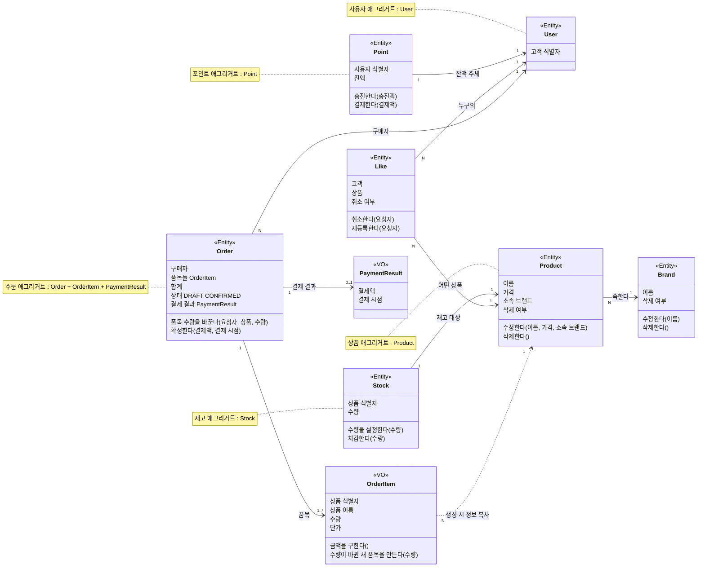
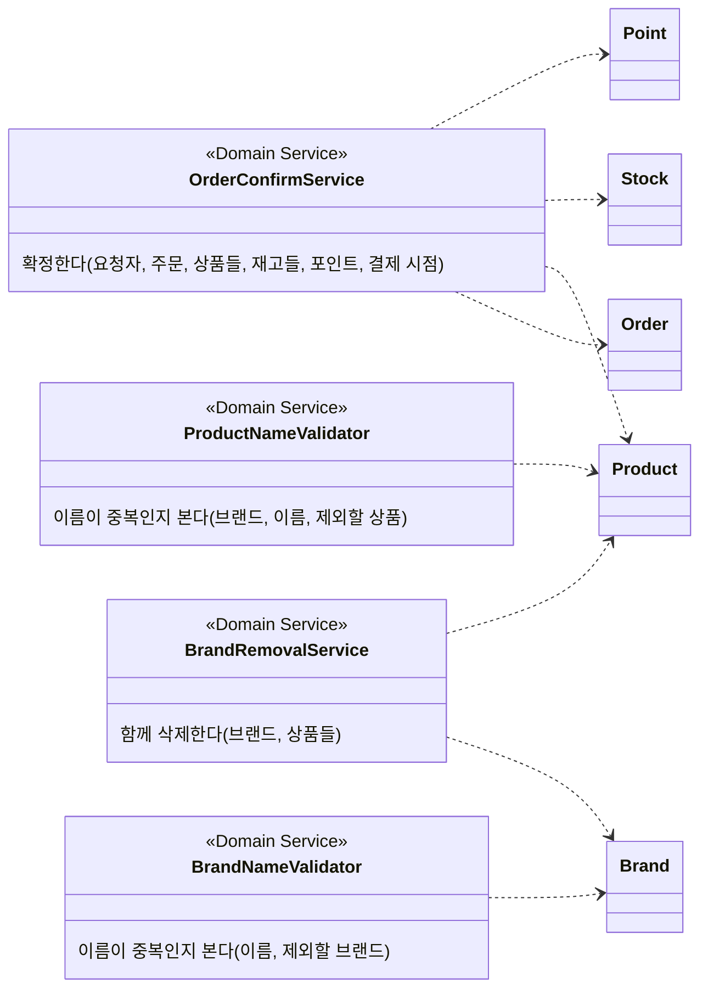

# commerce-api 도메인 관계

## 관계

| 관계 | 누가 누구를 아는가 |
| --- | --- |
| Brand 1 ── N Product | Product가 자신이 속한 Brand를 안다. Brand는 Product를 모른다. |
| User 1 ── 1 Point | Point가 잔액의 사용자 식별자를 가진다. User는 Point 상태를 소유하지 않는다. |
| Product 1 ── 1 Stock | Stock이 재고 대상 상품 식별자를 가진다. Product는 Stock 상태를 소유하지 않는다. |
| User 1 ── N Like N ── 1 Product | Like가 User와 Product를 안다. Product는 Like를 모른다. |
| Order 1 ── 1..N OrderItem | Order가 자신의 OrderItem을 가진다. |
| OrderItem → Product | OrderItem은 상품 엔티티를 참조하지 않고 생성 시점의 상품 식별자·이름·단가를 저장한다. |
| User 1 ── N Order | Order가 구매자인 User를 안다. |
| Order 1 ── 0..1 PaymentResult | Order가 자신의 결제 결과를 가진다. |

## 애그리거트와 책임

| 애그리거트 | 루트 | 묶인 값 | 소유하는 것 |
| --- | --- | --- | --- |
| 상품 | Product | 없음 | 이름·가격·소속 브랜드·삭제 여부 |
| 재고 | Stock | 없음 | 상품별 수량·재고 변경 규칙 |
| 사용자 | User | 없음 | 고객 식별자 |
| 포인트 | Point | 없음 | 사용자별 잔액·충전·결제 규칙 |
| 주문 | Order | OrderItem, PaymentResult | 구매자·품목·합계·상태·결제 결과 |

| 도메인 서비스 | 애그리거트 안에 둘 수 없는 이유 |
| --- | --- |
| `OrderConfirmService` | 주문·상품·재고·포인트 네 애그리거트의 상태를 함께 바꿔야 확정이 끝난다 |
| `BrandRemovalService` | `Brand`가 연결 상품을 모르므로 브랜드와 미삭제 상품의 상태를 함께 맞춘다 |
| `BrandNameValidator` | 한 `Brand`는 다른 `Brand` 전부를 볼 수 없다 |
| `ProductNameValidator` | 한 `Product`는 같은 브랜드의 다른 `Product`를 볼 수 없다 |
