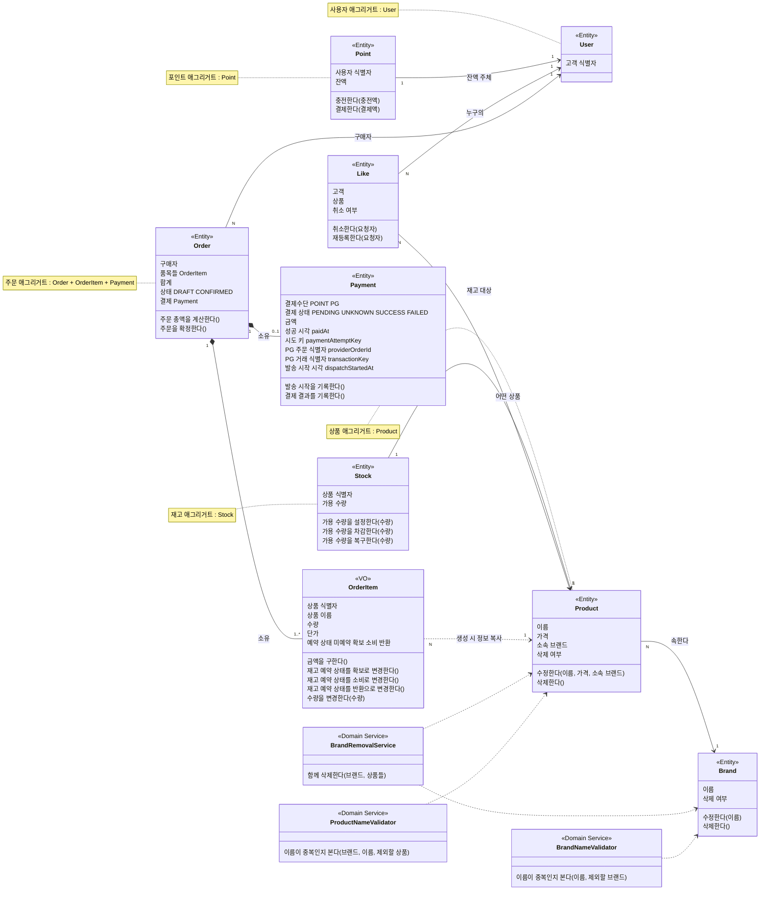

# commerce-api 도메인 관계

## 관계

| 관계                               | 누가 누구를 아는가                                               |
| -------------------------------- | -------------------------------------------------------- |
| Brand 1 ── N Product             | Product가 자신이 속한 Brand를 안다. Brand는 Product를 모른다.          |
| User 1 ── 1 Point                | Point가 잔액의 사용자 식별자를 가진다. User는 Point 상태를 소유하지 않는다.       |
| Product 1 ── 1 Stock             | Stock이 재고 대상 상품 식별자를 가진다. Product는 Stock 상태를 소유하지 않는다.   |
| User 1 ── N Like N ── 1 Product  | Like가 User와 Product를 안다. Product는 Like를 모른다.             |
| Order 1 ── 1..N OrderItem        | Order가 자신의 OrderItem을 가진다.                               |
| OrderItem → Product              | OrderItem은 상품 엔티티를 참조하지 않고 생성 시점의 상품 식별자·이름·단가를 저장한다.    |
| User 1 ── N Order                | Order가 구매자인 User를 안다.                                    |
| Order 1 ── 0..1 Payment | Order가 결제 시도와 결과를 하나의 Payment로 소유한다. 결제 시작 전에는 없으며 기존 POINT 결제도 보존한다. |

## 애그리거트와 책임

| 애그리거트 | 루트      | 내부 구성                                                      | 소유하는 것                             |
| ----- | ------- | ---------------------------------------------------------- | ---------------------------------- |
| 상품    | Product | 없음                                                         | 이름·가격·소속 브랜드·삭제 여부                 |
| 재고    | Stock   | 없음                                                         | 상품별 가용 수량·차감·반환 규칙                 |
| 사용자   | User    | 없음                                                         | 고객 식별자                             |
| 포인트   | Point   | 없음                                                         | 사용자별 잔액·충전·결제 규칙                   |
| 주문    | Order   | OrderItem, Payment | 구매자·품목·합계·주문 상태·결제 시도·예약·성공한 결제 사실 |

| 도메인 서비스                | 애그리거트 안에 둘 수 없는 이유                                                                                                                |
| ---------------------- | --------------------------------------------------------------------------------------------------------------------------------- |
| `BrandRemovalService`  | `Brand`가 연결 상품을 모르므로 브랜드와 미삭제 상품의 상태를 함께 맞춘다                                                                                      |
| `BrandNameValidator`   | 한 `Brand`는 다른 `Brand` 전부를 볼 수 없다                                                                                                  |
| `ProductNameValidator` | 한 `Product`는 같은 브랜드의 다른 `Product`를 볼 수 없다                                                                                         |

## 주문 내부의 책임

Order는 주문 전체의 일관성을 책임지는 애그리거트 루트다. 다이어그램에서는 주문 총액 계산과 주문 확정을 액션으로 표시한다. 내부 객체 생성·소유, 품목 교체·제거와 검증은 내부 책임으로 유지하되 그림에서 생략한다. OrderItem과 Payment의 세부 규칙을 대신 구현하지 않고, 각 객체에 위임한 결과가 주문 전체와 일치하도록 관리한다.

| 객체 | 책임 |
| --- | --- |
| Order | 소유권·주문·예약 상태를 확인하고 품목을 생성·제거하며, 변경된 VO를 내부 목록에 반영한다. 품목 금액을 합산해 최종 주문 금액을 결정한다. 결제 시작 가능 여부와 기존 결제를 확인하고 자신의 ID·저장된 총액으로 Payment를 생성·연결한다. 결제 성공과 품목 예약 상태를 확인한 뒤 주문을 CONFIRMED로 확정한다. |
| OrderItem | 수량을 검증하고 단가 × 수량으로 품목 금액을 계산한다. 예약·소비·해제의 상태 전이를 검증하고 변경된 새 VO를 반환한다. |
| Payment | 생성 이후 발송 기록·거래 정보·결제 상태·결과를 관리한다. 금액과 상태 전이를 검증하고 중복 발송·상충하는 결과·종결 상태의 역행을 막는다. 주문 상태와 재고는 직접 변경하지 않는다. |
| Stock | 가용 수량의 차감·반환 규칙을 지킨다. |
| 유즈케이스 | DB 조회·저장·잠금, TX A/B 경계, PG 호출과 대사를 조율한다. |

품목 수량 변경은 OrderItem이 담당한다. OrderItem이 수량을 검증해 새 VO를 반환하면 Order는 자신의 목록을 교체하고 총액을 다시 계산한다. 품목 교체와 주문 상태 검사는 내부 처리이며 다이어그램의 별도 행위로 나열하지 않는다. 예약 수량은 품목 수량과 같으며 별도로 저장하지 않는다. 예약 시작 후 품목 수량은 변경하지 않는다.

OrderItem은 Stock을 직접 참조하거나 호출하지 않는다. 유즈케이스가 상품 식별자로 두 객체를 대응시켜 같은 트랜잭션에서 품목 예약 상태와 가용 재고를 함께 변경한다.

품목 예약 상태는 미예약 → 확보 → 소비 또는 반환으로 전이한다. Order는 OrderItem이 반환한 새 VO로 자신의 목록을 교체한다. Payment는 Order가 자신의 ID와 결정한 총액으로 생성·연결한다. 생성 이후의 결제 관리는 Payment가 담당한다. Order는 Payment의 성공 상태를 확인해 주문을 확정하며 결제 상태 전이 규칙을 중복 구현하지 않는다.

TX A에서는 유즈케이스가 Order·Product·Stock의 규칙을 호출한다. Stock의 가용 수량을 차감하고, Order를 통해 품목을 확보 상태로 교체하고 Payment를 생성한다. 유즈케이스가 Payment에 발송 시작 기록을 요청하고, 결제·품목 예약·재고·발송 시작 기록을 함께 저장한 뒤 TX 밖에서 PG를 호출한다.

TX B에서는 유즈케이스가 검증된 결제 결과를 Order가 소유한 Payment에 기록하고, Order를 통해 품목 교체와 주문 확정을 수행한다. 성공이면 품목 예약을 소비하고 주문을 확정하며 재고를 추가 차감하지 않는다. 확정 실패이면 품목 예약을 반환 상태로 바꾸고 해당 수량만 Stock에 복구한다. 처리 중·미확인이면 DRAFT와 확보 상태를 유지한다.

콜백과 대사는 같은 결과 반영 유즈케이스를 사용한다. Order는 이번에 확보에서 반환 상태로 전이한 품목만 반환 대상으로 내준다. 중복 결과에는 반환 대상을 다시 내주지 않으며, 주문·결제·품목 상태 변경과 Stock 복구를 같은 TX에서 저장한다.

## 결제 저장 구조

Payment는 Order 내부 엔티티이며 별도 `payments` 테이블에 저장한다. 주문 상태는 `orders`에서, 결제 상태는 `payments`에서 관리한다. 결제 시작 시 행을 생성하고 같은 행에 진행 상태와 최종 결과를 반영한다.

| 컬럼 | 의미 |
| --- | --- |
| `order_id` | 주문 연결. UNIQUE로 주문당 결제 하나 보장 |
| `method` | POINT / PG |
| `status` | PENDING / UNKNOWN / SUCCESS / FAILED |
| `amount` | 결제 금액 |
| `paid_at` | 성공 시각. 성공 전에는 null |
| `payment_attempt_key` | 클라이언트 시도 키. PG 요청의 키 중복을 UNIQUE로 보호 |
| `provider_order_id` | PG에 전달한 주문 식별자 |
| `transaction_key` | PG가 발급한 거래 식별자. 확인 전에는 null |
| `dispatch_started_at` | 발송 시작 시각. 발송 전에는 null |

이전 POINT 결제는 당시 금액·성공 시각과 결제수단을 보존하고 PG 전용 필드는 null로 둔다. 실제 테이블 생성과 기존 데이터 이관은 구현 단계에서 수행한다. 카드 번호는 저장하지 않는다.

Payment 생성·연결은 Order가 담당한다. 유즈케이스는 Payment의 발송 기록·결과 기록 행위를 호출하고 DB 저장·PG 호출·대사를 조율한다. 발송 시작은 PG 호출 전에 영속 기록한다. 결제 결과 기록은 상태 전이·중복·충돌을 검사하고 상태·거래 키·성공 시각을 반영한다.
