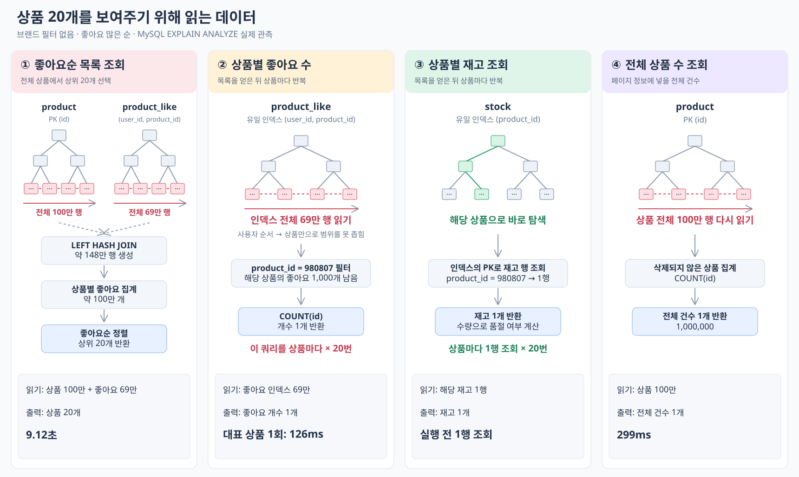

# 브랜드 필터 없는 좋아요순: 단건 3회 측정

측정일: 2026-10-14 (KST)

**부하 생성기 없이 순차 요청 3회 모두 HTTP 200으로 응답했고, 평균 10.568087초 걸렸다.**

## 요청과 조건

```http
GET /api/v1/products?sort=likes_desc&page=0&size=20
X-USER-ID: 1
```

- 서울 EC2 `54.117.65.124:8080`, `perf_skewed_1m_v1`, 상품 100만 개.
- 기존 좋아요순 요청에서 `brandId=7`만 제거했다. 전체 상품 중 좋아요 많은 20개를 조회한다.
- 로컬 curl로 한 요청이 완료된 뒤 다음 요청을 보냈다. 별도 부하·워밍업·캐시 초기화는 하지 않았다.
- `time_total`로 연결 수립·네트워크·서버 처리·응답 본문 수신까지 측정했다. 클라이언트 제한 시간은 30초다.

## 결과

| 요청 | HTTP | 전체 소요 시간(초) |
| --- | --- | ---: |
| 1 | 200 | 10.657091 |
| 2 | 200 | 10.513337 |
| 3 | 200 | 10.533834 |
| 평균 | — | 10.568087 |

3회 모두 20개 상품·전체 상품 수 1,000,000개를 반환했다. 세 응답의 데이터가 같았으며, CSV로 계산한 상위 상품 ID·순서·이름·가격·브랜드·좋아요 수·품절 여부·페이지 정보와 일치했다.

## 해석

- 앞서 브랜드 7로 제한한 단건 조회는 1.657999초였다. 이번 무필터 평균은 약 6.4배지만, 이전 결과는 1회이며 측정 시각·캐시 상태를 통제한 비교는 아니다.
- 세 요청 모두 기존 부하 실험의 5초 기준을 넘었다. 이번에는 제한 시간을 30초로 두어 실제 응답 완료까지 기다린 결과다.
- 단건 3회 관측이며 처리량 한계나 p95를 산출하는 부하 실험은 아니다. 이번 요청의 서버·SQL Trace는 별도로 수집하지 않아 지연 증가를 특정 SQL의 비용으로 확정하지 않는다.

## 실행계획: 20개를 보여 주려고 얼마나 읽었나

같은 DB에서 `EXPLAIN ANALYZE`로 각 SQL을 1회 실행한 결과다(2026-10-14).

| 작업 | 읽은 데이터 | 처리·반환 결과 | 시간 |
| --- | --- | --- | ---: |
| 좋아요순 목록 | **상품 100만 행 + 좋아요 인덱스 69만 행** | 조인 약 148만 행 → 상품별 집계 약 100만 행 → 정렬 후 **20개 반환** | **9.12초** |
| 상품 하나의 좋아요 수 | **좋아요 인덱스 69만 행 전부** | 해당 상품의 좋아요 1,000개를 찾아 개수 1개 반환 | **126ms** |
| 상품 하나의 재고 | `product_id` 인덱스로 **1행** | 재고 1개 반환 | 실행 전 1행 조회 |
| 전체 상품 수 | **상품 100만 행 전부** | 전체 건수 1개 반환 | **299ms** |

**20개만 읽는 게 아니라, 전체 상품·좋아요를 읽고 집계·정렬한 뒤 20개를 고른다.** 목록을 얻은 뒤에도 상품별 좋아요 집계를 20번 반복하고, 전체 상품 수를 세려고 상품 100만 행을 다시 읽는다. 좋아요·재고의 위 수치는 대표 상품 `980807` 한 건을 확인한 결과다.

### 실제 출력

아래 `actual`의 `rows`가 실제 처리 행 수다. 시간 단위는 ms이고 모두 `loops=1`이다. 단계별 시간은 겹치므로 더하지 않는다. 별도 SQL 측정이므로 API 응답 시간 10.57초와 합계를 맞추지는 않는다.

목록 조회:

```text
-> Limit: 20 row(s)  (actual time=9120..9120 rows=20 loops=1)
    -> Sort: `count(l.id)` DESC, p.id, limit input to 20 row(s) per chunk  (actual time=9120..9120 rows=20 loops=1)
        -> Table scan on <temporary>  (actual time=8621..8992 rows=1e+6 loops=1)
            -> Aggregate using temporary table  (actual time=8621..8621 rows=999999 loops=1)
                -> Left hash join (l.product_id = p.id)  (cost=6.84e+9 rows=68.3e+9) (actual time=144..1133 rows=1.48e+6 loops=1)
                    -> Filter: (p.deleted_at is null)  (cost=102540 rows=99401) (actual time=0.121..454 rows=1e+6 loops=1)
                        -> Table scan on p  (cost=102540 rows=994008) (actual time=0.12..388 rows=1e+6 loops=1)
                    -> Hash
                        -> Covering index scan on l using uk_product_like_user_product  (cost=9.58 rows=687578) (actual time=0.287..84.3 rows=690000 loops=1)
```

상품별 좋아요 수:

```text
-> Aggregate: count(product_like.id)  (cost=78358 rows=1) (actual time=126..126 rows=1 loops=1)
    -> Filter: (product_like.product_id = 980807)  (cost=71482 rows=68758) (actual time=0.419..126 rows=1000 loops=1)
        -> Covering index scan on product_like using uk_product_like_user_product  (cost=71482 rows=687578) (actual time=0.374..95.7 rows=690000 loops=1)
```

상품별 재고:

```text
-> Rows fetched before execution  (cost=0..0 rows=1) (actual time=87e-6..150e-6 rows=1 loops=1)
```

전체 상품 수:

```text
-> Aggregate: count(product.id)  (cost=115205 rows=1) (actual time=299..299 rows=1 loops=1)
    -> Filter: (product.deleted_at is null)  (cost=105265 rows=99401) (actual time=0.539..255 rows=1e+6 loops=1)
        -> Table scan on product  (cost=105265 rows=994008) (actual time=0.538..190 rows=1e+6 loops=1)
```

## 데이터 읽기 흐름



좋아요 인덱스는 `(user_id, product_id)` 순서라 **상품별 좋아요 수 조회도 리프 전체를 읽는다.** 재고는 `product_id` 유일 인덱스로 해당 상품 1행을 찾는다.

## 일반 EXPLAIN

[출력 원본](explain-traditional/e801069-baseline.txt) · [실행 SQL](explain-traditional/e801069-baseline.sql) · [당시 구성 재현 정보](explain-traditional/e801069-baseline.json).

해당 커밋의 쿼리·인덱스를 별도 로컬 MySQL 8.0.46에서 재현해 추가 수집했다. 기존 EC2 측정 당시 출력과는 구분한다. `rows`는 추정치이며 실제 읽은 행 수·loops·시간은 기존 `EXPLAIN ANALYZE`를 참고한다. [재현 범위](../historical-explain.md).
