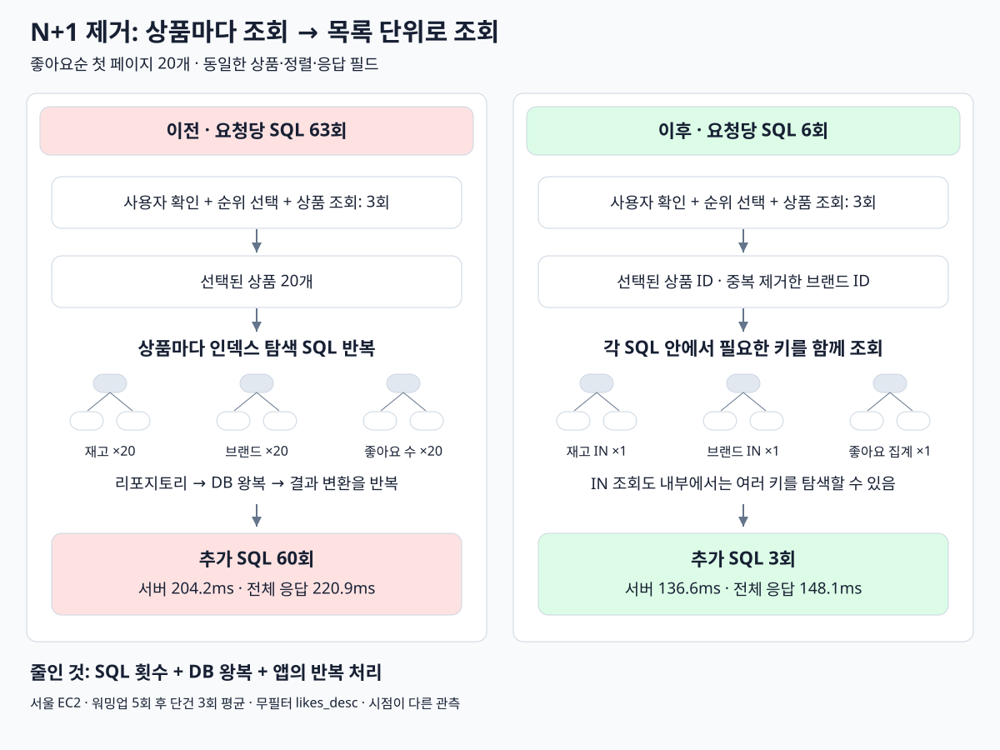

# 상품 목록 N+1 개선

상품 20개의 재고·브랜드·좋아요 수를 각각 한 번에 조회하도록 변경했다. 브랜드 ID는 중복을 제거한다. 캐시·저장된 좋아요 카운터는 추가하지 않았다.

```text
이전: 상품별 재고 20회 + 브랜드 20회 + 좋아요 수 20회
이후: 재고 IN 1회 + 브랜드 IN 1회 + 좋아요 GROUP BY 1회
```

## 비교 결과

2026-10-14 서울 EC2, 무필터 `likes_desc`, `page=0`, `size=20`. 두 버전 모두 같은 상세 계측으로 워밍업 5회 후 단건 3회를 순차 측정했다. 프론트 제외, DB 버퍼 풀 유지. 측정 시점은 다르며 부하 한계 실험은 아니다.

| 항목 | 이전 | 이후 |
| --- | ---: | ---: |
| 요청당 SQL 수 | 63회 | 6회 |
| 서버 처리 | 204.2ms | 136.6ms |
| 클라이언트 전체 응답 | 220.9ms | 148.1ms |
| SQL 실행 합계 | 132.2ms | 101.2ms |
| 리포지토리 처리 — SQL/JDBC 제외 | 51.9ms | 17.7ms |
| 재고·브랜드·좋아요 조회 — SQL/JDBC 포함 | 91.5ms | 18.1ms |

**서버 처리 약 33.1%, 전체 응답 약 33.0% 감소.** SQL과 앱의 반복 처리 비용이 함께 줄었다. 표의 세부 구간은 서로 포함 관계이므로 모두 더하지 않는다.

| 측정 | 서버 처리 | 전체 응답 |
| --- | ---: | ---: |
| 1회 | 131.1ms | 142.3ms |
| 2회 | 145.3ms | 157.6ms |
| 3회 | 133.4ms | 144.3ms |

이번 6회 SQL은 사용자 확인·좋아요순 후보 선택·상품 상세·브랜드·재고·좋아요 수다. 좋아요순 후보 선택은 여전히 약 93ms로 남는다. 빈 목록·브랜드 필터·뒤쪽 페이지에서는 실행 경로에 따라 SQL 수가 달라질 수 있다.

응답의 상품·순서·필드와 `last`는 동일했다. 좋아요 0개·재고 없음의 기본값, 삭제 제외·필터·정렬·페이지 경계를 유지했다. 관련 HTTP·통합·계측·ArchUnit 228개 테스트와 Checkstyle 통과. 상품 1개와 20개 목록 모두 SQL 6회인 회귀 테스트를 포함한다.

배포 이미지: `commerce-api:week4-batch-20261014`. JAR SHA-256: `7288896aeceeb64d47a314616f5755a2afcd0449d4724e9de197d379b83cc16a`.
원본: `build/04-optimize-likes-query/stage-timing/` / `batch-timing/`. Run ID: `stages-1791918986` / `batch-1791919496`.

## 조회 흐름 비교


