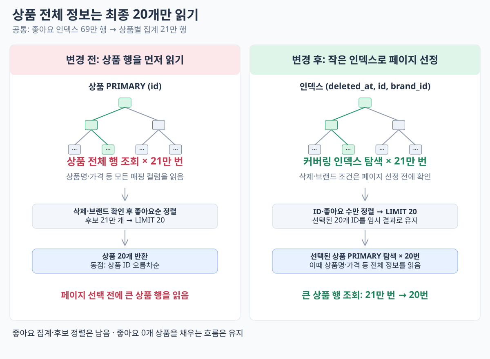

# 페이지 선정 후 상품 전체 정보 조회

2026-10-14. 좋아요순 후보의 ID·좋아요 수만 정렬해 페이지를 고른 뒤, 해당 상품의 전체 정보를 조회한다. 삭제·브랜드 필터는 페이지 선정 전에 적용하고, 최종 결과도 좋아요 수 DESC·ID ASC로 정렬한다. 좋아요 0개 구간의 처리와 기존 API 응답 계약은 유지한다.

필터 확인용 `(deleted_at, id, brand_id)` 인덱스를 추가했다. MySQL이 기존 PK를 선택했으므로 후보 조회에 `FORCE INDEX (idx_product_likes_filter)`를 지정했다. **기존 DB 배포 시 [인덱스 SQL](add-product-filter-index.sql)을 앱보다 먼저 적용해야 한다.** Product 매핑에도 같은 인덱스를 반영했다.

## 실행 계획

```text
좋아요 인덱스 69만 행 → 상품별 집계 21만 행
→ 후보 상품의 커버링 인덱스 탐색 × 21만 번 (삭제·브랜드 확인)
→ ID·좋아요 수 정렬 → LIMIT 20
→ 선택된 상품 PK 탐색 × 20번 → 상품 전체 정보 반환
```

별도 `EXPLAIN ANALYZE`에서 후보 단계는 `Covering index lookup ... idx_product_likes_filter`, 최종 단계는 `Single-row index lookup ... PRIMARY ... loops=20`으로 확인했다.

직전 방식의 목록 SQL은 1.650초였다. 이번 변경은 인덱스 생성 후 최초 지정 실행 2.756초, 반복 실행 0.860초였다. 캐시 초기화 없는 관측이므로 0.860초만으로 개선 폭을 확정하지 않는다. 필터 인덱스 추가와 페이지 선정 순서를 함께 변경한 결과이며 각각의 효과를 분리 측정하지 않았다.

전체 건수 조회와 상품별 좋아요·재고 재조회는 유지한다. 인덱스 갱신 비용이 추가되며, 다른 데이터 분포에서는 강제 인덱스 선택이 유리한지 다시 확인해야 한다.

## 단건 3회 결과

서울 앱에 `commerce-api:week4-page-first-20261014`로 배포했다. 소스는 `3575b51` 이후 이번 변경 포함, JAR SHA-256은 `2060e69d741ab5e47f8ad6a253be61e6ef216ab42d2fbb13416b737d78f6a086`이다. 앱·DB·Redis 상태 UP을 확인했다.

기존과 동일한 `GET /api/v1/products?sort=likes_desc&page=0&size=20`, `X-USER-ID: 1`을 부하 없이 순차 3회 요청했다. curl `time_total`, 제한 시간 30초, 캐시 초기화 없음, 재배포 후 첫 상품 요청 포함이다.

| 요청 | HTTP | 시간(초) |
| --- | --- | ---: |
| 1 | 200 | 1.302535 |
| 2 | 200 | 0.982669 |
| 3 | 200 | 1.033136 |
| 평균 | — | **1.106113** |

세 응답 모두 기존과 전체 JSON이 동일했다. [직전 방식](report-positive-first.md)의 평균 **1.750905초 → 1.106113초**, 약 **0.645초(37%) 감소**했다. 서로 다른 시점의 각 3회 관측이며, 부하 한계 측정은 아니다.

기존 조회 통합·HTTP·ArchUnit·Checkstyle 검사를 통과했다. 삭제·브랜드 필터, 동점 순서, 혼합 페이지, 전체 0개 및 뒤쪽 페이지의 기대값은 유지했다. 커버링 인덱스 생성 통합 검사를 추가했다.

## 데이터 읽기 흐름



## 현재 SQL 단계별 시간

2026-10-14, 동일 무필터 첫 페이지 SQL을 순차 3회 `EXPLAIN ANALYZE`로 재측정했다. 결과 캐시는 없고 DB 버퍼 풀은 비우지 않았다. SQL 전체는 **881 / 873 / 898ms, 평균 884ms**였다. [실행 계획 원본](page-first-stage-analysis.txt)

| 단계 | 처리량 | 시간(3회 평균, 근사) |
| --- | --- | ---: |
| 좋아요 인덱스 읽기 | 69만 행 | 78ms |
| 상품별 개수 집계 | 21만 상품으로 묶기 | 44ms 추가 |
| 집계 임시 결과 생성·읽기 | 21만 행 | 43ms 추가 |
| 상품 조건 확인·조인 | 커버링 인덱스 탐색 21만 번 | **678ms 추가** |
| 정렬기로 결과 전달 | 21만 후보 | 21ms 추가 |
| 좋아요순 상위 20개 선정 | 21만 후보 → 20개 | 19ms 추가 |
| 최종 상품 전체 정보 조회 | PK 탐색 20번 | 약 0.12ms |

**가장 큰 비용은 상품 조건 확인·조인(약 77%)이다.** 정렬 자체가 대부분을 차지하는 것은 아니다. 좋아요 읽기와 집계만 합쳐도 이번 계측에서는 약 122ms였다.

표는 부모·자식 누적 시간의 차이로 근사 분해했다. 최종 상품 조회는 평균 반복 시간 × 20으로 계산했다. 출력 반올림·반복 측정 오버헤드 때문에 정확한 독립 구간 합산값은 아니며, `EXPLAIN ANALYZE` 계측 시간과 일반 SQL 실행 시간은 구분한다. 누적 시간과 반복 평균의 의미는 [MySQL 공식 문서](https://dev.mysql.com/doc/refman/8.0/en/explain.html)를 따른다.

## 일반 EXPLAIN

[출력 원본](explain-traditional/ce77577.txt) · [실행 SQL](explain-traditional/ce77577.sql) · [당시 구성 재현 정보](explain-traditional/ce77577.json).

해당 커밋의 쿼리·인덱스를 별도 로컬 MySQL 8.0.46에서 재현해 추가 수집했다. 기존 EC2 측정 당시 출력과는 구분한다. `rows`는 추정치이며 실제 읽은 행 수·loops·시간은 기존 `EXPLAIN ANALYZE`를 참고한다. [재현 범위](../historical-explain.md).
