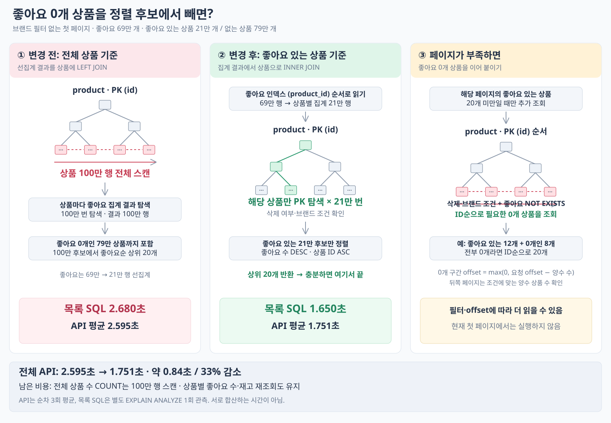

# 좋아요 있는 상품 우선 조회

2026-10-14. 좋아요가 있는 상품만 집계·상품 INNER JOIN·필터·정렬한다. 정렬은 좋아요 수 내림차순, 동점 상품 ID 오름차순이다. 페이지가 부족하면 `NOT EXISTS`로 좋아요 0개 상품을 ID순으로 이어 붙인다.

좋아요 있는 상품을 일부 반환한 페이지는 0개 구간의 처음부터 채운다. 해당 구간에서 아무것도 반환하지 않은 뒤쪽 페이지는 **요청 offset − 조건에 맞는 좋아요 있는 상품 수**를 0개 구간 offset으로 사용한다. 전체가 0개여도 같은 방식으로 페이지를 유지한다.

## 실행 계획

브랜드 필터 없는 첫 페이지의 별도 `EXPLAIN ANALYZE` 관측이다.

```text
좋아요 인덱스 69만 행 읽기
→ 상품별 집계 21만 행
→ 상품 PK 탐색 × 21만 번 (삭제 상품 제외)
→ 좋아요 수 DESC, 상품 ID ASC 정렬
→ 20개 반환
```

이전 선집계 LEFT JOIN의 상품 100만 행 스캔이 **상품 PK 탐색 21만 번**으로 바뀌었다. 목록 SQL은 이전 2.680초, 이번 1.650초였다. 전체 상품 수 조회의 100만 행 스캔과 상품별 좋아요 개수 재조회는 남는다. 0개 구간에서는 별도 조회·필요시 건수 조회 비용이 든다.

기존 통합 테스트에 혼합 페이지·0개 구간 다음 페이지·전체 0개·범위 밖 페이지를 보완했다. 삭제·브랜드 필터와 동점 순서를 포함해 통합·HTTP·ArchUnit·Checkstyle 검사를 통과했다.

## 단건 3회 결과

서울 앱에 `commerce-api:week4-positive-first-20261014`로 배포했다(미커밋 코드 포함). 기존과 동일한 `GET /api/v1/products?sort=likes_desc&page=0&size=20`, `X-USER-ID: 1` 요청을 순차 3회 보냈다. curl `time_total`, 제한 시간 30초, 캐시 초기화 없음, 재배포 후 첫 상품 요청 포함이다.

| 요청 | HTTP | 시간(초) |
| --- | --- | ---: |
| 1 | 200 | 1.721031 |
| 2 | 200 | 1.897440 |
| 3 | 200 | 1.634245 |
| 평균 | — | **1.750905** |

세 응답 모두 이전과 전체 JSON이 동일했다. [이전 선집계 LEFT JOIN](report-preaggregate.md)의 평균 **2.595312초 → 1.750905초**, 이번 3회 관측에서는 약 33% 감소했다. 서로 다른 시점의 단건 측정이며 부하 한계 측정은 아니다.

## 데이터 읽기 흐름


