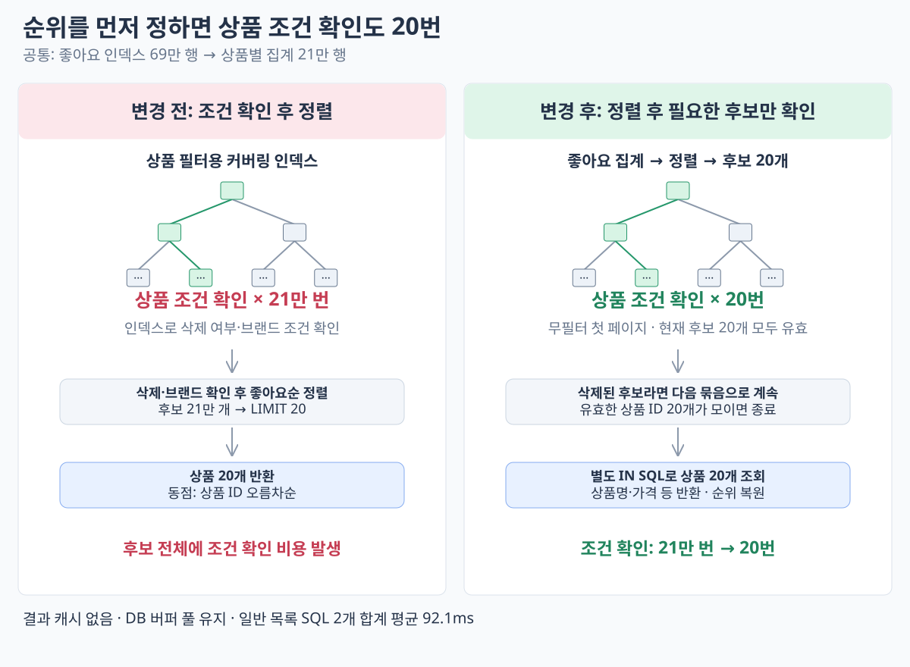

# 순위를 먼저 정하고 필요한 상품만 확인

2026-10-14. 무필터 좋아요순 조회를 **집계 → 좋아요 수 DESC·ID ASC 정렬 → 상위 후보의 삭제 여부 확인** 순서로 변경했다. 브랜드 필터가 있는 조회는 이전 방식을 유지한다.

첫 페이지는 후보 20개부터 확인한다. 삭제된 후보도 결과에 남겨 진행 위치를 추적하고, 유효한 상품이 부족하면 다음 후보 묶음을 확인한다. 묶음 크기는 2배씩 최대 1,024개까지 늘린다. 충분한 유효 ID를 모으면 상세 정보를 IN 조회로 한 번에 가져오고 순위를 복원한다. 묶음 안에서는 필요한 개수보다 많이 조건을 확인할 수 있다.

페이지 번호는 유지한다. 앞 페이지에 해당하는 **유효 상품만 건너뛰며**, 좋아요 있는 후보가 끝나면 남은 offset으로 좋아요 0개 상품을 채운다. 다음 요청은 처음부터 다시 찾고, 추가 묶음마다 집계·정렬이 반복되므로 뒤쪽 페이지·삭제가 많은 분포에는 추가 비용이 있다.

## 목록 SQL 측정

현재 첫 페이지는 **후보 SQL 1회 + 상품 상세 SQL 1회**다. 후보 20개가 모두 유효하므로 추가 후보 조회는 발생하지 않았다. [측정 SQL](rank-first-measurement.sql)

| 순차 실행 | 후보·조건 확인 | 상품 20개 상세 | DB 실행 시간 합계 |
| --- | ---: | ---: | ---: |
| 1 | 90.696ms | 0.403ms | 91.099ms |
| 2 | 91.257ms | 0.387ms | 91.644ms |
| 3 | 93.148ms | 0.382ms | 93.530ms |
| 평균 | 91.700ms | 0.390ms | **92.091ms** |

`SET profiling=1` / `SHOW PROFILES`의 일반 SELECT 실행 시간이다. 결과 캐시·저장된 카운터는 사용하지 않았으며, DB 버퍼 풀은 비우지 않았다. **이번 3회에서 목록을 구성하는 두 SQL의 합계가 100ms 미만**이었다. 네트워크·앱 처리·전체 건수·추가 재고 및 좋아요 조회는 포함하지 않는다. 콜드 DB나 부하 상태에서의 100ms 보장은 아니다.

## 실행 계획

```text
좋아요 인덱스 69만 행 → 집계 21만 행
→ 좋아요 수 DESC·ID ASC 정렬 → 상위 후보 20개
→ 상품 커버링 인덱스로 삭제 확인 × 20번
→ 유효 ID의 상품 전체 정보 IN 조회 (별도 SQL)
```

후보 SQL의 `EXPLAIN ANALYZE`는 155ms였다. 집계까지 120ms, 결과 전달까지 138ms, 상위 후보 선정까지 155ms였고, 상품 인덱스 확인은 `loops=20`이었다. **21만 번 확인하던 상품 조건을 이번 첫 페이지에서는 20번만 확인한다.** EXPLAIN의 행별 계측과 일반 SELECT 프로파일은 측정 방식이 다르므로 155ms와 위 92ms를 같은 기준으로 비교하지 않는다.

## 배포·API 확인

`commerce-api:week4-rank-first-20261014`로 서울 앱에 배포했다. 소스는 `d4dcf33` 이후 이번 변경 포함, JAR SHA-256 `b1bd0ded8612b4385ce6735253ea37a2d536626cc873a7af32eeb2517e4cf4a6`이다.

동일 무필터 좋아요순 첫 페이지 API를 부하 없이 순차 3회 요청했다. curl `time_total`, 제한 시간 30초, 재시작 후 첫 요청 포함이다. **0.679371 / 0.357742 / 0.350359초**, 평균 **0.462491초**였고 모두 HTTP 200·기존과 전체 JSON 동일했다. 직전 평균 1.106113초와는 서로 다른 시점의 비교다.

기존 테스트에 무필터 삭제 후보 건너뛰기, 다음 페이지, 0개 구간과 전체 0개 사례를 보완했다. 통합·HTTP·ArchUnit·Checkstyle 검사를 통과했다.

## 데이터 읽기 흐름



## 일반 EXPLAIN

[출력 원본](explain-traditional/1eed148.txt) · [실행 SQL](explain-traditional/1eed148.sql) · [당시 구성 재현 정보](explain-traditional/1eed148.json).

해당 커밋의 쿼리·인덱스를 별도 로컬 MySQL 8.0.46에서 재현해 추가 수집했다. 기존 EC2 측정 당시 출력과는 구분한다. `rows`는 추정치이며 실제 읽은 행 수·loops·시간은 기존 `EXPLAIN ANALYZE`를 참고한다. [재현 범위](../historical-explain.md).
