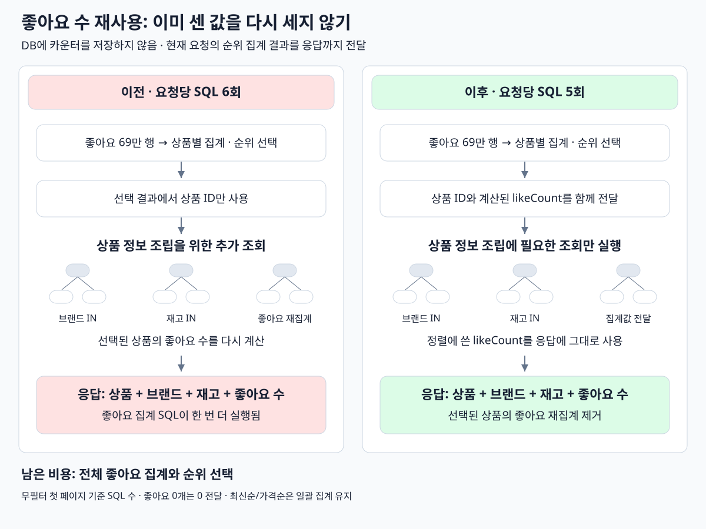

# 좋아요 정렬 집계값 재사용

좋아요순 후보 조회에서 계산한 `likeCount`를 응답까지 전달한다. 선택한 상품의 좋아요를 다시 집계하는 SQL 1회를 제거했다. DB에 카운터를 저장하거나 결과를 캐시하지 않는다.

## 단건 3회 비교

2026-10-14 서울 EC2, 무필터 `likes_desc`, `page=0`, `size=20`. 이전 N+1 개선 버전과 같은 데이터·상세 계측으로 워밍업 5회 후 3회를 순차 실행했다. 프론트 제외, DB 버퍼 풀 유지.

| 항목 | N+1 개선 후 | 집계값 재사용 후 |
| --- | ---: | ---: |
| 요청당 SQL | 6회 | **5회** |
| 서버 처리 평균 | 136.6ms | **130.3ms** |
| 전체 응답 평균 | 148.1ms | **143.7ms** |
| SQL 실행 합계 평균 | 101.2ms | 98.4ms |

| 측정 | 서버 처리 | 전체 응답 |
| --- | ---: | ---: |
| 1회 | 128.6ms | 146.0ms |
| 2회 | 134.4ms | 145.5ms |
| 3회 | 127.9ms | 139.6ms |

**중복 집계는 없어졌고 서버 처리 평균은 약 6.3ms 줄었다.** 서로 다른 시점의 3회 관측이라 작은 시간 차이를 안정적인 개선 폭으로 단정하지 않는다. 전체 좋아요 69만 행의 집계·정렬은 여전히 남는다.

남은 SQL: 사용자 확인 → 좋아요순 후보 선택 → 상품 상세 → 브랜드 일괄 조회 → 재고 일괄 조회.

세 응답 전체가 이전과 동일했다. 관련 테스트 229개(HTTP·통합·계측·ArchUnit), Checkstyle 통과. 상품 1개·20개 모두 SQL 5회이며 재집계가 없음을 확인했다. 삭제·브랜드 필터·좋아요 0개·동점·페이지 경계도 확인했다.

최신순·가격순은 선택된 상품의 좋아요 일괄 집계를 유지한다. 브랜드 필터 경로는 후보 ID·개수 조회와 상품 상세 조회를 분리했다. 위 시간·SQL 수는 무필터 첫 페이지의 결과다.

배포: `commerce-api:week4-reuse-count-20261014` · JAR SHA-256: `682e689ce46f0daed3dbc307ba2f2a21f1f9221c0da19904575cdaceedbfb5d1`.
원본: `build/04-optimize-likes-query/batch-timing/`, `reuse-timing/`. Run: `batch-1791919496` → `reuse-1791920158`.

## 조회 흐름 비교

