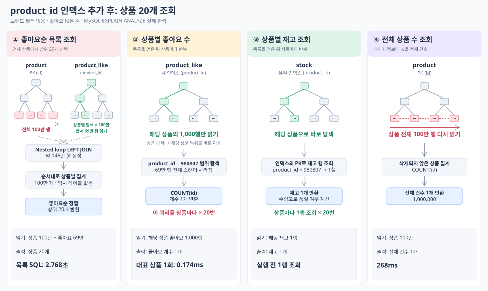

# 좋아요 product_id 인덱스 추가

2026-10-14, 서울 실험 DB `perf_skewed_1m_v1`의 `product_like`에 `idx_product_like_product_id (product_id)`를 추가했다. 기존 인덱스·데이터는 유지했다. [적용 SQL](add-product-like-index.sql)

측정은 앱 재배포 없이 DB 인덱스만 추가한 상태에서 진행했다. 이후 `Like.java`에도 같은 인덱스 매핑을 반영했다. 새 DB의 인덱스 생성 통합 테스트·ArchUnit·Checkstyle을 통과했다. 기존 DB는 DDL 자동 적용을 끈 환경이므로 SQL로 적용해야 한다.

2026-10-14 코드 반영 후 `commerce-api:week4-product-index-20261014`로 재배포했다(미커밋 변경 포함). 앱·DB·Redis 상태 UP, 좋아요순 목록 HTTP 200을 확인했다. 재시작 후 확인 요청은 3.012초이며 위 인덱스 비교 측정과는 별개다.

## 단건 3회 결과

```http
GET /api/v1/products?sort=likes_desc&page=0&size=20
X-USER-ID: 1
```

부하 없이 curl로 한 요청이 끝난 뒤 다음 요청을 보냈다. 제한 시간 30초, `time_total` 기준이며 캐시는 초기화하지 않았다.

| 요청 | HTTP | 인덱스 추가 후(초) |
| --- | --- | ---: |
| 1 | 200 | 2.679294 |
| 2 | 200 | 2.542144 |
| 3 | 200 | 2.693511 |
| 평균 | — | **2.638316** |

추가 전 평균 **10.568087초 → 추가 후 2.638316초**, 약 4.0배 빨라졌다. 서로 다른 시점의 각 3회 관측이다. [추가 전 결과](../03-baseline-likes/report-no-brand.md)

세 응답 모두 추가 전과 상품·순서·전체 필드·페이지 정보가 같았다. 좋아요 건수도 적용 전후 690,000개로 동일하다.

## 상품 하나의 좋아요 집계

```sql
SELECT COUNT(id) FROM product_like WHERE product_id = 980807;
```

| 비교 | 읽은 데이터 | EXPLAIN ANALYZE 시간 |
| --- | --- | ---: |
| 추가 전 | 좋아요 인덱스 전체 **690,000행** | 126ms |
| 추가 후 | 해당 상품의 좋아요 **1,000행** | 0.174ms |

```text
-> Aggregate: count(product_like.id)  (cost=203 rows=1) (actual time=0.174..0.174 rows=1 loops=1)
    -> Covering index lookup on product_like using idx_product_like_product_id (product_id=980807)  (cost=103 rows=1000) (actual time=0.0205..0.132 rows=1000 loops=1)
```

**상품별 좋아요 수를 셀 때 전체 스캔 대신 해당 상품 범위만 읽는다.** 이 쿼리의 N+1 호출 횟수는 그대로이며, 각 SQL 시간은 별도 단건 측정이다.

## 데이터 읽기 흐름

목록 SQL도 **Hash Join + 임시 테이블 집계 → Nested Loop Join + 순차 집계**로 실행 계획이 바뀌었다. 별도 `EXPLAIN ANALYZE` 관측은 9.12초 → 2.768초다. 상품 100만 행 읽기와 좋아요순 정렬은 남아 있다.

좋아요 인덱스는 상품마다 총 100만 번 탐색한다. 탐색당 평균 0.69행, 합계 69만 행을 반환한다.



## 일반 EXPLAIN

[출력 원본](explain-traditional/770c082.txt) · [실행 SQL](explain-traditional/770c082.sql) · [당시 구성 재현 정보](explain-traditional/770c082.json).

해당 커밋의 쿼리·인덱스를 별도 로컬 MySQL 8.0.46에서 재현해 추가 수집했다. 기존 EC2 측정 당시 출력과는 구분한다. `rows`는 추정치이며 실제 읽은 행 수·loops·시간은 기존 `EXPLAIN ANALYZE`를 참고한다. [재현 범위](../historical-explain.md).
