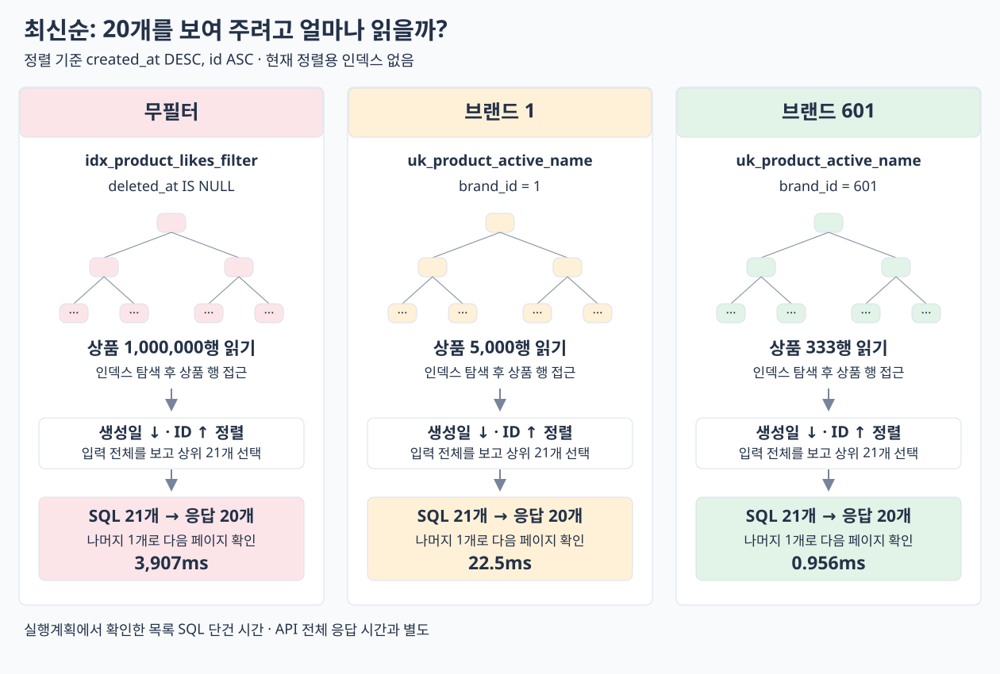

# 최신순 최적화 전 측정

서울 EC2, `sort=latest&page=0&size=20`. 무필터·브랜드 1·601을 번갈아 순차 조회했다. 각각 워밍업 3회 후 단건 3회 평균, 프론트 제외. 코드·인덱스 변경 전 기록이다.

## 단건 결과

| 조건 | 전체 응답 | 서버 처리 | 목록 SQL | SQL 수 |
| --- | ---: | ---: | ---: | ---: |
| 무필터 | 3988.4ms | 3942.6ms | 3920.0ms | 5회 |
| 브랜드 1 | 168.1ms | 155.1ms | 132.9ms | 6회 |
| 브랜드 601 | 42.3ms | 29.9ms | 3.5ms | 6회 |

**무필터는 상품 100만 행을 읽고 최신순으로 정렬해서 약 4초가 걸린다.** N+1은 이미 제거되어 있고, 이번 병목은 목록 SQL이다.

## 실행계획: 20개를 보여 주려고 얼마나 읽었나

API 측정이 끝난 뒤 같은 목록 SQL에 `EXPLAIN ANALYZE`를 별도로 실행했다. 21번째 상품은 `last` 판정에 쓰고 응답에는 20개만 넣는다.

| 조건 | 읽은 데이터 | 정렬·반환 | 별도 실행계획 시간 |
| --- | --- | --- | ---: |
| 무필터 | `idx_product_likes_filter`로 미삭제 상품 **100만 행** | 생성일 내림차순·ID 오름차순 → 21개 | 3,907ms |
| 브랜드 1 | 브랜드 인덱스로 상품 **5,000행** | 같은 정렬 → 21개 | 22.5ms |
| 브랜드 601 | 브랜드 인덱스로 상품 **333행** | 같은 정렬 → 21개 | 0.956ms |

현재 인덱스는 삭제 여부·브랜드를 찾는 데 쓰이지만 생성일순으로 정렬돼 있지 않다. 특히 무필터에서는 삭제되지 않은 상품이 100만 개라 인덱스를 사용해도 읽는 양이 줄지 않는다. 조회 컬럼을 모두 담은 인덱스도 아니어서 상품 행 접근이 필요하다.

### 실제 출력

```text
CASE None
-> Limit: 21 row(s)  (cost=55229 rows=21) (actual time=3907..3907 rows=21 loops=1)
    -> Sort: p1_0.created_at DESC, p1_0.id, limit input to 21 row(s) per chunk  (cost=55229 rows=497004) (actual time=3907..3907 rows=21 loops=1)
        -> Index lookup on p1_0 using idx_product_likes_filter (deleted_at=NULL), with index condition: (p1_0.deleted_at is null)  (cost=55229 rows=497004) (actual time=0.224..3778 rows=1e+6 loops=1)

CASE 1
-> Limit: 21 row(s)  (cost=3484 rows=21) (actual time=22.5..22.5 rows=21 loops=1)
    -> Sort: p1_0.created_at DESC, p1_0.id, limit input to 21 row(s) per chunk  (cost=3484 rows=9576) (actual time=22.5..22.5 rows=21 loops=1)
        -> Filter: (p1_0.deleted_at is null)  (cost=3484 rows=9576) (actual time=0.43..21.9 rows=5000 loops=1)
            -> Index lookup on p1_0 using uk_product_active_name (brand_id=1)  (cost=3484 rows=9576) (actual time=0.429..21.5 rows=5000 loops=1)

CASE 601
-> Limit: 21 row(s)  (cost=122 rows=21) (actual time=0.953..0.956 rows=21 loops=1)
    -> Sort: p1_0.created_at DESC, p1_0.id, limit input to 21 row(s) per chunk  (cost=122 rows=333) (actual time=0.952..0.953 rows=21 loops=1)
        -> Filter: (p1_0.deleted_at is null)  (cost=122 rows=333) (actual time=0.105..0.892 rows=333 loops=1)
            -> Index lookup on p1_0 using uk_product_active_name (brand_id=601)  (cost=122 rows=333) (actual time=0.104..0.868 rows=333 loops=1)
```

`rows`가 실제 읽은 행 수다. Sort의 top-N 처리는 상위 21개를 고르는 과정이지 입력 21개만 읽었다는 뜻이 아니다. 실행계획 시간은 별도 실행값이며 API 평균과 더하거나 같은 값으로 보지 않는다. 브랜드 SQL 시간 차이는 측정 시점·버퍼 상태 등이 달라 원인을 단정하지 않는다.

## 다음 비교

무필터 `(deleted_at, created_at DESC, id ASC)`, 브랜드 필터 `(brand_id, deleted_at, created_at DESC, id ASC)` 인덱스를 후보로 둔다. 정렬된 순서로 앞의 21개만 읽을 수 있는지 비교한다. 아직 적용하지 않았다.

세 번씩 모두 HTTP 200·20상품·`last=false`, 브랜드 일치·중복 없음·조건별 응답 동일을 확인했다. 배포는 `commerce-api:week4-brand-first-20261014` (`40a08b3`에 기록된 코드), 데이터는 `perf_skewed_1m_v1` 그대로다.

원본: `build/05-optimize-latest-query/`, Run `latest-1791941807`. [실행 SQL](explain-before.sql) · [실행계획 출력](explain-before.txt).

## 데이터 읽기 흐름



후속: [최신순 인덱스 적용 전후 비교](report-index.md) · [디스크·인덱스 용량](storage.md).
