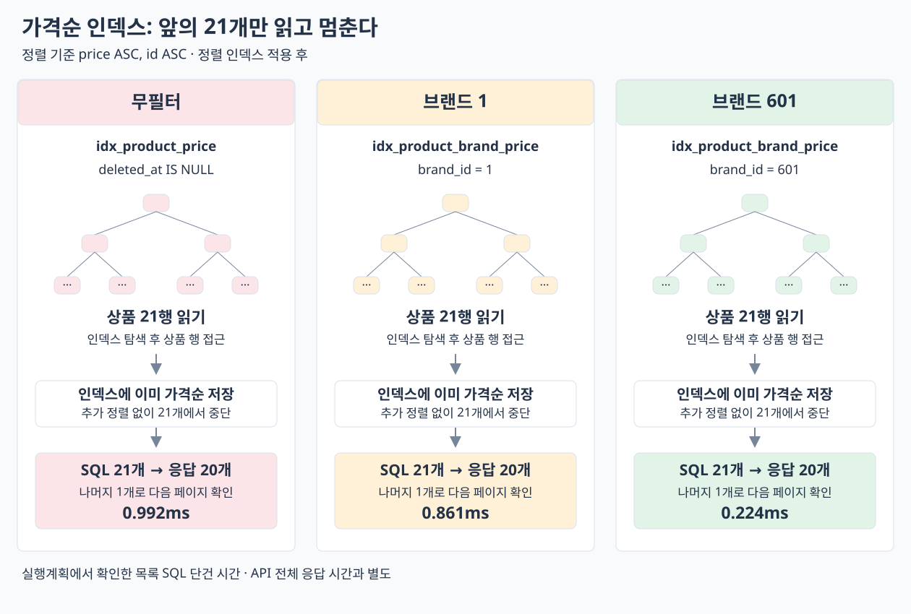

# 가격순 복합 인덱스 적용

상품 테이블에 `(deleted_at, price ASC, id ASC)`와 `(brand_id, deleted_at, price ASC, id ASC)`를 추가했다. [적용 SQL](add-price-indexes.sql). 기존 인덱스·쿼리·응답 계약은 유지했다.

## 단건 3회 비교

같은 서울 EC2 앱에서 재배포 없이 DB 인덱스만 추가. `price_asc`, `page=0`, `size=20`, 각 조건 워밍업 3회 후 순차 3회 평균. 프론트 제외.

| 조건 | 전체 응답 전 → 후 | 서버 처리 전 → 후 | 목록 SQL 전 → 후 |
| --- | ---: | ---: | ---: |
| 무필터 | 3273.1 → 28.5ms | 3222.6 → 16.9ms | 3198.7 → 1.4ms |
| 브랜드 1 | 186.4 → 24.1ms | 172.5 → 11.8ms | 147.1 → 1.4ms |
| 브랜드 601 | 44.8 → 23.2ms | 31.7 → 10.6ms | 7.2 → 0.8ms |

무필터 전체 응답 약 115배 개선. SQL 횟수는 무필터 5회·브랜드 필터 6회로 동일하고, 세 번씩 응답 전체가 적용 전과 같았다. 이 수치는 단건 관측이며 부하 한계·p95를 뜻하지 않는다.

## 실행계획: 필요한 21행만 읽는다

| 조건 | 읽은 상품 전 → 후 | 추가 정렬 | 이후 별도 실행계획 시간 |
| --- | ---: | --- | ---: |
| 무필터 | 1,000,000 → 21행 | 없어짐 | 0.992ms |
| 브랜드 1 | 5,000 → 21행 | 없어짐 | 0.861ms |
| 브랜드 601 | 333 → 21행 | 없어짐 | 0.224ms |

```text
CASE None
-> Limit: 21 row(s)  (cost=62828 rows=21) (actual time=0.984..0.992 rows=21 loops=1)
    -> Index lookup on p1_0 using idx_product_price (deleted_at=NULL), with index condition: (p1_0.deleted_at is null)  (cost=62828 rows=497004) (actual time=0.982..0.989 rows=21 loops=1)

CASE 1
-> Limit: 21 row(s)  (cost=4167 rows=21) (actual time=0.854..0.861 rows=21 loops=1)
    -> Index lookup on p1_0 using idx_product_brand_price (brand_id=1, deleted_at=NULL), with index condition: (p1_0.deleted_at is null)  (cost=4167 rows=5000) (actual time=0.853..0.859 rows=21 loops=1)

CASE 601
-> Limit: 21 row(s)  (cost=549 rows=21) (actual time=0.217..0.224 rows=21 loops=1)
    -> Index range scan on p1_0 using idx_product_brand_price over (brand_id = 601 AND deleted_at = NULL), with index condition: ((p1_0.deleted_at is null) and (p1_0.brand_id = 601))  (cost=549 rows=333) (actual time=0.216..0.222 rows=21 loops=1)
```

인덱스가 필터 구간 안에서 가격·ID 순서를 유지하므로 Sort 없이 앞의 21행을 읽는다. 20개는 응답, 나머지 1개는 `last` 판정용이다. 상품명 등 인덱스에 없는 컬럼은 상품 행에서 가져오므로 전체 목록 쿼리의 covering index는 아니다. 실행계획 시간은 별도 측정이며 API 시간에 더하지 않는다.

JPA에 두 인덱스를 반영하고 컬럼·정렬 방향 검증을 추가했다. 기존 상품 정렬·필터·페이지 경계·HTTP·계측·ArchUnit을 포함한 231개 테스트 및 Checkstyle 통과. EC2는 DDL 자동 적용이 꺼져 있어 SQL로 적용했다. 앱 이미지는 `commerce-api:week4-brand-first-20261014` 유지.

[적용 전](report.md) · [디스크 사용량 전후](storage.md). 원본: `build/06-optimize-price-query/after/`, Run `priceindex-1791943528`.

## 데이터 읽기 흐름


