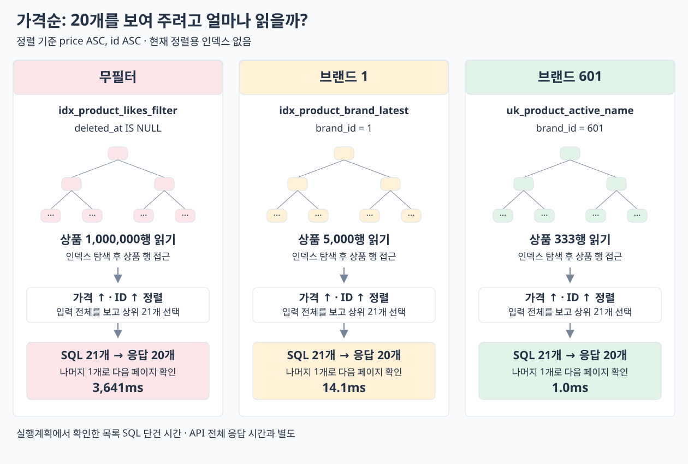

# 가격순 현재 상태

서울 EC2, `price_asc`, `page=0`, `size=20`. 무필터·브랜드 1·601을 번갈아 순차 조회, 각 조건 워밍업 3회 후 단건 3회 평균. 프론트 제외. 최신순 인덱스가 있는 상태이며 가격순 코드·인덱스는 변경하지 않았다.

| 조건 | 전체 응답 | 서버 처리 | 목록 SQL | SQL 수 |
| --- | ---: | ---: | ---: | ---: |
| 무필터 | 3273.1ms | 3222.6ms | 3198.7ms | 5회 |
| 브랜드 1 | 186.4ms | 172.5ms | 147.1ms | 6회 |
| 브랜드 601 | 44.8ms | 31.7ms | 7.2ms | 6회 |

**가격순도 무필터 목록 SQL이 병목이다.** 최신순 인덱스는 생성일 순서라 가격 정렬을 없애지 못한다.

## 실행계획: 읽은 행 수

별도 `EXPLAIN ANALYZE`에서 무필터는 100만 행, 브랜드 1은 5,000행, 브랜드 601은 333행을 읽고 가격·ID 오름차순으로 정렬해 21개를 선택했다. 21번째 상품은 `last` 판정용이다.

```text
CASE None
-> Limit: 21 row(s)  (cost=56982 rows=21) (actual time=3641..3641 rows=21 loops=1)
    -> Sort: p1_0.price, p1_0.id, limit input to 21 row(s) per chunk  (cost=56982 rows=497004) (actual time=3641..3641 rows=21 loops=1)
        -> Index lookup on p1_0 using idx_product_likes_filter (deleted_at=NULL), with index condition: (p1_0.deleted_at is null)  (cost=56982 rows=497004) (actual time=0.399..3529 rows=1e+6 loops=1)

CASE 1
-> Limit: 21 row(s)  (cost=2264 rows=21) (actual time=14.1..14.1 rows=21 loops=1)
    -> Sort: p1_0.price, p1_0.id, limit input to 21 row(s) per chunk  (cost=2264 rows=5000) (actual time=14.1..14.1 rows=21 loops=1)
        -> Index lookup on p1_0 using idx_product_brand_latest (brand_id=1, deleted_at=NULL), with index condition: (p1_0.deleted_at is null)  (cost=2264 rows=5000) (actual time=0.308..13.5 rows=5000 loops=1)

CASE 601
-> Limit: 21 row(s)  (cost=134 rows=21) (actual time=1..1 rows=21 loops=1)
    -> Sort: p1_0.price, p1_0.id, limit input to 21 row(s) per chunk  (cost=134 rows=333) (actual time=1..1 rows=21 loops=1)
        -> Filter: (p1_0.deleted_at is null)  (cost=134 rows=333) (actual time=0.117..0.949 rows=333 loops=1)
            -> Index lookup on p1_0 using uk_product_active_name (brand_id=601)  (cost=134 rows=333) (actual time=0.117..0.927 rows=333 loops=1)
```

무필터는 `idx_product_likes_filter`, 브랜드 1은 최신순 실험에서 추가한 `idx_product_brand_latest`, 브랜드 601은 `uk_product_active_name`을 사용했다. 필터 범위는 줄일 수 있어도 가격순으로 정렬되어 있지 않아 Sort가 남는다. 위 실행계획 시간은 API 측정과 별도이며 합산하지 않는다.

세 요청씩 모두 HTTP 200·상품 20개·`last=false`, 가격·ID 정렬과 브랜드 일치·중복 없음·반복 응답 동일을 확인했다. API 전체 응답 평균을 부하 한계나 p95로 해석하지 않는다.

원본: `build/06-optimize-price-query/`, Run `price-1791943186`. [실행 SQL](explain-before.sql).

## 데이터 읽기 흐름



후속: [가격순 인덱스 적용 전후 비교](report-index.md) · [디스크 전후](storage.md).
