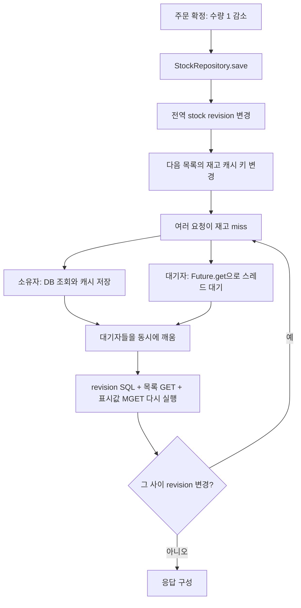

# 로컬 Single Flight 병목 분석

## 결론

원본 목록 중복 조회는 줄었지만, **구매 때마다 표시 재고 캐시를 무효화하는 구조 + 대기 후 전체 응답 재조회 + HTTP 작업 스레드 점유**가 남아 있다. 원본 SQL만 느린 상황으로 설명되지 않는다. 앱 CPU·Tomcat 포화와 서버 계측 밖 대기가 관측되며, Future 대기·큐 대기·CPU 비용 각각의 비중은 아직 직접 측정하지 않았다.

## 코드에서 확인한 경로

- `ProductUseCase.findStockStatuses`의 캐시 값은 상품 ID와 **soldOut**이다. 하지만 `CacheWriteConfiguration`은 수량 저장마다 전역 `stock` revision을 변경한다.
- 각 회차 601건 구매 동안 대상 상품 최소 재고는 3,621,364→3,621,334 / 3,621,334→3,621,304 / 3,621,304→3,621,274였다. 모두 양수라 품절 여부는 바뀌지 않았다. 표시 값이 같아도 캐시는 새 키로 바뀐다.
- 원본 재고 조회는 601/611/582회였다. 구매 10건/초로 revision이 평균 약 100ms마다 바뀌는 입력이므로, 재고 캐시는 설정 TTL 5분보다 쓰기 무효화가 실질 수명을 결정한다. 실제 커밋 간격은 일정하지 않다.
- 모든 상품에 동일한 stock revision을 사용한다. 다른 상품의 구매도 이 페이지 재고 키를 바꿀 수 있다. 이번 입력은 첫 페이지 상품 20개를 구매하므로 상품별 범위 축소만으로 이 실험의 모든 miss가 사라지지는 않는다.
- 로컬 구현은 완성 결과를 공유하지 않고 `CompletableFuture<Void>` 완료 신호만 공유한다. 대기자는 깨어나면 `CatalogReadTransaction`의 while 처음부터 실행한다. 사용자/경로별 응답을 섞지 않는 대신 revision·캐시 재확인 비용이 발생한다.
- Future 대기는 트랜잭션 밖이어서 DB 커넥션은 잡지 않는다. 그러나 동기 HTTP 작업 스레드는 반환하지 않는다. 완료 시 대기자들이 동시에 깨어나 재조회한다. 이를 단순히 DB 풀 고갈이라고 부르면 부정확하다.

## 관측 근거

| 회차 | 원본 목록 횟수 | 목록 최대 동시 | 재고 원본 횟수 | 원본 조회 없이 revision 재확인한 읽기 표본 | Hikari pending 최대 | Tomcat busy 최대 |
| --- | ---: | ---: | ---: | --- | ---: | ---: |
| 1 | 41 | 3 | 601 | 322 / 752 (42.8%) | 1 | 200 |
| 2 | 44 | 4 | 611 | 464 / 1,036 (44.8%) | 129 | 200 |
| 3 | 38 | 3 | 582 | 438 / 1,044 (42.0%) | 0 | 200 |

재확인은 같은 읽기 trace에서 revision SELECT가 두 번 이상이고 목록·좋아요 수·재고 원본 stage가 없는 경우다. follower 재조회와 일치하지만 follower 전용 지표가 없으므로 전부 follower라고 단정하지 않는다. 읽기 trace는 약 1% 표본이며 전체 요청 수로 취급하지 않는다.

앱 CPU 평균 169.91/180.60/180.75%, 최대 약 198%(2코어). 읽기 커넥션 획득 평균은 11.89/9.77/10.22ms였다. 3회차에서 pending 표본이 0인데도 읽기 p99 841ms이므로 DB 풀 대기 하나로 전체 지연을 설명할 수 없다. 표본 사이 순간 대기는 배제할 수 없다.

## 같은 구매 요청끼리 비교한 서버 밖 시간

PURCHASE_JSON의 index와 두 서버 trace의 request ID를 연결했다. 회차마다 **601건 모두** 생성·확정 trace와 매칭했다. 서로 다른 모집단의 p99를 빼지 않고 구매별 `client 전체 시간 - 생성 serverDuration - 확정 serverDuration`을 계산했다.

| 회차 | 구매 평균 | 두 API 서버 시간 합 평균 | 나머지 시간 평균 |
| --- | ---: | ---: | ---: |
| 1 | 3,712.06ms | 323.27ms | 3,388.78ms |
| 2 | 1,803.72ms | 184.10ms | 1,619.62ms |
| 3 | 633.15ms | 157.11ms | 476.04ms |

나머지는 **Tomcat 큐 시간 그 자체가 아니다.** 서버 계측 시작 전 처리 대기·네트워크·부하기/응답 파싱 등이 섞여 있다. 다만 k6 전체 HTTP의 blocked p99는 0.34/0.29/0.30ms, receiving p99는 2.11/2.62/3.03ms이고 대부분의 지연이 waiting(TTFB)에 있었다. Tomcat busy 200과 함께 보면 서버 진입 전 적체가 유력하다. 전용 큐 타이머나 같은 구간 스레드 덤프가 없어 확정하지 않는다. 부하기 CPU는 평균 약 194~214%(8코어), 순간 최대 724~742%도 있어 부하기 영향을 완전히 배제하지 않는다.

## DB revision 자체의 비용

표본 읽기 한 건당 revision SELECT는 평균 약 1.80/1.63/1.58회였다. 전부 hit이어도 인증 SELECT와 revision SELECT가 남는다. Single Flight는 원본 로더만 조율하므로 이 호출들은 합쳐지지 않는다.

구매 확정은 서로 다른 상품이어도 같은 `read_cache_revision`의 stock 행을 갱신한다. revision UPDATE SQL은 회차별 601개이며 평균 35.90/11.95/9.65ms, p99 491.16/82.99/88.87ms였다. 공통 행 쓰기 경합 후보지만 JDBC 실행 시간에는 통신·스케줄링도 포함한다. 전역 InnoDB row lock 카운터만으로 대기 행을 확정하지 않는다.

## 다음 검증 순서

1. Single Flight를 유지한 revision 우회 실험으로 revision SQL·쓰기 무효화가 없는 조건의 차이를 본다. **무효화까지 없어지므로 SQL 한 번의 비용만 분리한 실험은 아니다.** 오래된 표시 값을 허용하는 진단용이며 정상 정합성 검증과 분리한다.
2. 정상 계약을 유지하려면 표시 재고 캐시의 변경 조건·무효화 범위를 검토한다. soldOut이 바뀌는 경계, 생성·삭제·브랜드 삭제 보호는 유지해야 한다. 여기서는 정책을 바꾸거나 구현하지 않았다.
3. Single Flight leader/follower 수·대기 시간·재시도 횟수, 완료 동시 기상, Tomcat 진입 전 대기, JFR/CPU profile을 직접 계측한다. 스레드 수만 늘려 해결됐다고 하지 않는다.

## 재현 가능한 분석 자료

- [원래 보고서](report.md), [당시 구현 보존본](implementation.patch)
- run-1/2/3의 `bottleneck-evidence.json`: 요청 ID로 연결한 구매별 원본 쌍, SQL·stage 분포, 재조회 횟수.
- 같은 폴더의 `mixed-observations.json`, `before.json`, `after.json`, `purchase-audit.json`, `results/*measure*/server.log`, `client.log`, `summary.json`.
- 공통 분석: `python3 docs/week4/experiments/support/analyze_mixed_bottleneck.py docs/week4/experiments/32-single-flight-mixed`

분석은 저장된 실험 로그로 수행했다. 분석을 위해 부하를 추가하거나 배포를 변경하지 않았다.
