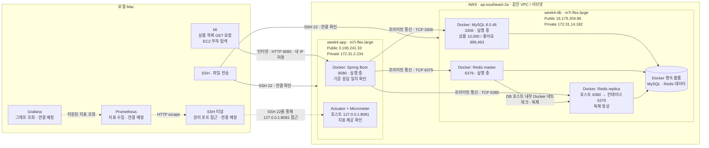

# 조회 성능 실험 시스템 구성

작성일: 2026-10-13

앱과 DB를 EC2 두 대로 분리하고, 로컬 Mac에서 상품 목록 조회 부하를 발생시킨다. 두 EC2는 시드니 리전의 같은 VPC·서브넷에 있으며, 서로 프라이빗 IP로 통신한다.

## 전체 구성

실선은 확인된 연결, 점선은 설정·검증이 남은 연결이다. 화살표는 요청 또는 데이터 전달 방향이며 응답은 같은 연결로 돌아온다.

앱→DB의 세 포트 연결과 앱 서버 내부 HTTP 응답 검증이 완료됐다. Redis 컨테이너는 준비됐지만 **상품 조회의 Redis cache-aside는 아직 구현하지 않았다.** 지금 측정하려는 기준선은 DB 조회 경로다.

## 요청과 지표의 흐름

| 흐름 | 동작 |
| --- | --- |
| 상품 조회 | 로컬 k6 → 앱의 퍼블릭 IP:8080 → MySQL의 프라이빗 IP:3306 → 앱 → k6 |
| 현재 앱 처리 | 사용자 확인, 상품 목록·재고·좋아요 수·브랜드·전체 건수 조회 후 응답 구성. 실제 SQL 횟수는 별도 계측 예정 |
| Redis | master/replica 준비 완료. 캐시 구현 후 앱에서 재사용하며, 기본 읽기 연결의 replica 선호 정책과 별도 master 연결을 실험에 명시 |
| 앱 지표 | Prometheus가 SSH 터널을 통해 Actuator 지표를 수집하고 Grafana가 조회하도록 연결할 예정 |
| 서버 관리 | 로컬 Mac → 각 EC2의 퍼블릭 IP:22. 같은 SSH 키로 접속 |

현재 API 앞에 Nginx나 로드 밸런서는 없다. 로컬→EC2 인터넷 지연은 k6 응답 시간에 포함되므로, 서버 내부 시간도 함께 기록한다. Actuator 지표만으로 DB 호스트의 CPU·디스크 상태나 요청별 SQL Trace를 모두 알 수 있는 것은 아니며, 해당 수집은 [실험 계획](load-test/plan.md)에 따라 추가한다.

## 장비와 연결 설정

| 항목 | 앱 서버 | DB 서버 |
| --- | --- | --- |
| 인스턴스 | m7i-flex.large · 2 vCPU · RAM 8 GiB | 동일 |
| OS / 아키텍처 | Ubuntu 26.04 LTS / x86_64 | 동일 |
| 디스크 | 현재 20 GiB 볼륨 | 현재 20 GiB 볼륨 |
| 실행 구성 | Spring Boot 컨테이너 1개 | MySQL·Redis master·Redis replica 컨테이너 3개 |
| 보안 그룹 | `sg-00780bd7938254d89` | `sg-040925c8912903dff` |
| 인바운드 규칙 | 22·8080은 로컬 Mac의 공인 IP만 허용 | 22는 로컬 IP, 3306·6379·6380은 앱 보안 그룹만 허용 |

위 인바운드는 필요한 규칙이다. SSH와 앱→DB 연결, 앱 서버 내부 API 응답은 확인됐으며 외부 API 8080의 HTTP 200과 기준 응답 일치도 확인했다. 관리 포트 8081은 호스트 loopback에만 공개한다. Prometheus/Grafana는 EC2 배포 대상으로 실행하지 않았고, 로컬 연결 설정도 아직 완료하지 않았다.

DB와 Redis는 같은 EC2의 CPU·메모리·디스크를 공유한다. 이후 캐시 실험에서도 이 자원 공유를 기록한다. MySQL은 `perf_uniform_10k_v1` 데이터베이스를 사용하고, 앱은 `ddl-auto=none`으로 연결하도록 설정돼 있다.

실제 배포 명령·검증 기록은 [EC2 배포 문서](../../docker/ec2/README.md), 부하 단계·Trace 수집 계획은 [실험 계획](load-test/plan.md)을 따른다.
