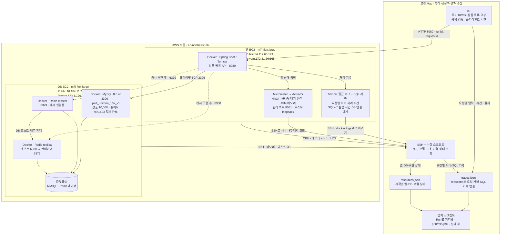

# 조회 성능 실험 시스템 구성

작성일: 2026-10-13

**서울 EC2 두 대에 앱과 DB를 분리하고, 로컬 Mac에서 부하와 측정 결과를 관리한다.** 두 서버는 서울 `ap-northeast-2b`이며 앱→DB는 프라이빗 IP로 연결한다.

**서울 서비스 배포·데이터 적재가 완료됐다.** 기준 응답·요청별 서버/SQL Trace·앱 지표 수집을 확인했으며, 아래 구성으로 baseline을 측정한다.

## 서비스와 실험 도구

서비스 연결 화살표는 요청 방향이며 응답은 같은 연결로 돌아온다. 수집 화살표는 기록이 이동하는 방향이다. 서버가 로컬에 접속하는 것이 아니라 로컬 수집기가 SSH로 가져온다. Redis 점선은 향후 캐시 조회 경로이며 **baseline 상품 조회는 MySQL을 사용한다.**

## 도구별 역할

| 도구 | 담당 | 남기는 기록 |
| --- | --- | --- |
| k6 | 부하 발생·응답 검증. HTTP 호출 직전부터 본문 수신 완료까지 측정 | 요청별 클라이언트 시간·상태, Run별 부하 결과 |
| Tomcat 접근 로그 | 요청 처리 시작부터 응답 처리 완료까지 측정 | 요청별 서버 처리 시간·HTTP 상태·requestId |
| SQL 계측 | JDBC 실행 호출과 DB 연결 획득 대기 측정 | 요청별 SQL·각 실행 시간·연결 대기 시간 |
| Micrometer | Hikari 연결 사용·대기, JVM 메모리 등 앱 상태 측정 | 앱 전체의 상태 지표 |
| Actuator | Micrometer 지표를 관리 HTTP API로 제공 | 수집기가 주기적으로 조회하는 지표 응답 |
| SSH + 수집 스크립트 | 앱 지표·서버 자원·Docker 로그·로컬 자원을 수집 | 요청별 Trace와 시각별 자원 파일 |
| 집계 스크립트 | 요청별 기록을 Run 단위로 집계 | 처리량·지연 분포·실패 건수·보고서 |

**요청별 서버 시간은 Tomcat 로그에서, 그 시각의 앱 전체 상태는 Actuator·Micrometer에서 확인한다.** 예를 들어 “이 요청은 DB 연결을 2초 기다림”과 “당시 연결 40개 사용 중·20개 요청 대기”를 시간대로 맞춰 보는 방식이다. 숫자는 설명용 예시다.

Tomcat 로그만으로 개별 SQL 시간을 알 수 없으므로 별도 SQL 계측을 연결한다. JDBC 실행 시간에는 결과를 객체로 만드는 비용이 전부 포함되지 않는다. 클라이언트 시간과 서버 시간의 차이도 모두 네트워크 지연으로 단정하지 않는다.

## 장비와 연결 설정

| 항목 | 앱 서버 | DB 서버 |
| --- | --- | --- |
| 확인된 인스턴스 | m7i-flex.large · x86_64 | 동일 |
| 확인된 사양 | 2 vCPU · RAM 8 GiB · Ubuntu 26.04 LTS | 동일 |
| 실제 루트 파일시스템 | 약 19.6 GB (20 GiB 볼륨) | 동일 |
| 실행 컨테이너 | Spring Boot 1개 | MySQL·Redis master·replica 3개 |
| 필요한 인바운드 | 22·8080: 로컬 Mac 공인 IP | 22: 로컬 IP, 3306·6379·6380: 앱 보안 그룹 |

OS·파일시스템과 앱→DB 세 포트 연결을 확인했다. 보안 그룹 규칙은 실행 환경 기록에서 별도로 확인한다. 관리 포트 8081은 호스트 `127.0.0.1`에만 공개한다. 앱은 `ddl-auto=none`으로 연결하고, DB·Redis는 같은 EC2의 CPU·메모리·디스크를 공유한다.

API 앞에 Nginx·로드 밸런서는 두지 않는다. Prometheus 수집 서버·Grafana도 구축하지 않고 로컬 파일로 결과를 관리한다.

- [서울 장비 확인 기록](experiments/environments/ec2-seoul.md)
- [Baseline 계획서](experiments/01-baseline/plan.md) · [공통 프로토콜](experiments/protocol.md)
- [예비 측정 보관본](experiments/preliminary/README.md): 기존 로컬·시드니 결과이며 서울 baseline과 구분한다.
